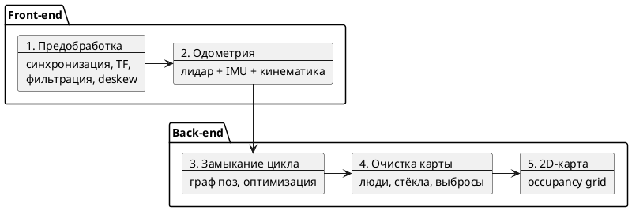

# Общий обзор технологий

Контекст: [[Условия квалификационного этапа]], [[2026-11-13 17-00 Вебинар Код города — Сервисная робототехника (транскрипт)|вебинар]].

**Задача алгоритма (сценарий 1):** по записи полного обхода офиса робособакой (~3–5 минут, одно замыкание цикла) офлайн восстановить траекторию и построить 2D-карту помещения (occupancy grid).

**Входные данные:**
- сырые разреженные облака лидара;
- сырой IMU;
- одометрия по кинематике робота;
- кадры камеры с выделенными точками (вместо изображений);
- калибровки и TF;
- схематичный план помещения.

## Этапы алгоритма

## 1. Предобработка

- **Синхронизация**: датчики пишут с разной частотой и без аппаратной синхронизации. Все данные приводятся к общей шкале времени (интерполяция, ApproximateTime); пропуски и разрывы обрабатываются отдельно.
- **Системы координат**: все измерения переводятся в систему базы робота через TF из калибровок (положение + поворот, кватернионы, SE(3)).
- **Фильтрация облака**:
  - прореживание (voxel grid);
  - удаление выбросов;
  - обрезка по дальности и высоте, в том числе удаление точек, попавших на корпус робота.
- **Инициализация IMU**: на неподвижном отрезке в начале записи оцениваются bias и направление гравитации.
- **Deskew**: устранение искажения облака от движения за время скана, по IMU или по одометрии.

## 2. Одометрия

Пошаговая оценка движения робота между соседними моментами времени. Ошибка этой оценки со временем накапливается (дрейф).

- **Лидарная одометрия**: сопоставление соседних сканов или скана с локальной картой (ICP, GICP, NDT). Готовые реализации — KISS-ICP, а также FAST-LIO2 и Point-LIO, которые работают и на разреженных облаках.
- **Лидар-инерциальная (LIO)**: IMU предсказывает движение между сканами, лидар корректирует (итеративный EKF в FAST-LIO2, факторный граф в LIO-SAM).
- **Кинематическая одометрия**: добавляется в EKF/UKF или как дополнительные ограничения в граф. Учитывать, что шагающая походка даёт заметный шум.
- **Визуальная одометрия** по кадрам с точками: сопоставление точек между кадрами, PnP / эпиполярная геометрия. Дополнительный источник там, где лидару не за что зацепиться.
- **Вырожденные сцены**: в длинных коридорах без текстуры лидар не видит смещения вдоль коридора. Нужно определить такое вырождение (по собственным числам матрицы ICP) и в этом направлении доверять кинематике и IMU.

## 3. Замыкание цикла и оптимизация

- **Граф поз**: узлы — ключевые положения робота, рёбра — относительные смещения из одометрии.
- **Обнаружение замыкания**: робот вернулся в уже пройденное место. Способы: поиск по близости положения, дескрипторы сцены (Scan Context), проверка совпадения через ICP.
- **Оптимизация графа**: ошибка, накопленная к месту замыкания, распределяется по всей траектории (GTSAM, g2o, Ceres; готовые решения — slam_toolbox, Cartographer).
- **Опора на план помещения** (опционально): дополнительные ограничения или проверка — стены должны быть прямыми и совпадать с планом.
- После оптимизации все сканы заново собираются в общую карту по исправленным положениям.

## 4. Очистка карты

- **Динамические объекты (люди)**: точки, которые в одних сканах есть, а в других через то же место проходит луч, считаются динамическими и удаляются (ray casting, ERASOR, Removert). Распознавать людей не нужно.
- **Стёкла и отражения**: лучи без возврата или с отражённым «фантомным» препятствием за стеклом. Отбрасываются по интенсивности и геометрии, либо по плану помещения.
- **Шум**: статистическое удаление одиночных точек и мелких кластеров.

## 5. Построение 2D occupancy grid

- Из 3D-облака берётся срез по диапазону высот (выше пола и ниже потолка) и проецируется на плоскость.
- Для каждой ячейки по лучам от датчика накапливается вероятность занятости (log-odds): ячейки, через которые луч прошёл, становятся свободными, а ячейка, где он закончился, — занятой.
- Итоговые значения: занято / свободно / неизвестно.
