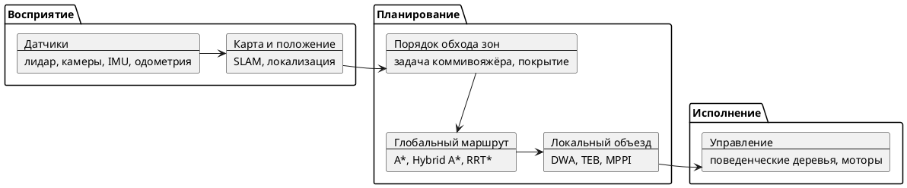

# Общий обзор технологий

Контекст: [[Условия квалификационного этапа]] — мобильный робот сам обходит заданные зоны на объекте и строит маршрут с учётом статических и динамических препятствий.

## Как устроена система в целом

## 1. Платформа и инструменты

- **ROS 2** (Humble / Jazzy) — стандартная «операционка» для роботов, на ней собирается почти всё остальное.
- **Nav2** — готовый стек навигации для ROS 2: карты, планировщики, объезд, восстановление при ошибках.
- **Симуляторы**: Gazebo (Harmonic), Webots, NVIDIA Isaac Sim — проверка алгоритмов без реального робота.
- **Поведенческие деревья** (BehaviorTree.CPP) — описание логики миссии: «доехать → осмотреть → вернуться на зарядку».
- **Open-RMF** — если роботов несколько: распределение задач и разведение на маршрутах.

## 2. Датчики

- **Лидар** (2D и 3D) — основной источник расстояний до препятствий.
- **RGB-D / стереокамеры** (Intel RealSense, ZED, OAK-D) — картинка + глубина.
- **IMU и колёсная одометрия** — «чувство движения» робота.
- Для инспекции: **тепловизор**, камера высокого разрешения, иногда газоанализаторы.

## 3. Карта и понимание «где я»

- **SLAM** — одновременное построение карты и определение положения:
  - 2D: slam_toolbox, Cartographer;
  - 3D по лидару: FAST-LIO2, LIO-SAM, KISS-ICP;
  - визуальный: ORB-SLAM3, RTAB-Map.
- **Локализация на готовой карте**: AMCL (фильтр частиц), сопоставление облаков точек (ICP, NDT).
- **Слияние датчиков**: расширенный фильтр Калмана (robot_localization).
- **Представление карты**: сетка занятости (occupancy grid), карты стоимости (costmaps), 3D-воксели (OctoMap).
- Тренд: **семантические карты** — на карте отмечено не только «занято/свободно», но и «дверь», «щиток», «человек».

## 4. Порядок обхода зон

- **Задача коммивояжёра / маршрутизации** — в каком порядке посетить точки осмотра; решатели Google OR-Tools, LKH, эвристики (ближайший сосед, 2-opt), генетические алгоритмы.
- **Планирование покрытия** (если зону нужно «прочесать» целиком): бустрофедон («змейка»), спираль, Spanning Tree Coverage; библиотека Fields2Cover.
- **Разбиение зон на ячейки** для покрытия — декомпозиция Бустрофедона, Морса.

## 5. Глобальный маршрут (статические препятствия)

- **Поиск на сетке**: Dijkstra, A*, Theta* (более «гладкие» пути), D* Lite (быстрая перестройка при изменении карты).
- **С учётом поворотов робота**: Hybrid A*, State Lattice (в Nav2 — Smac Planner).
- **Случайные выборки** для сложных пространств: RRT, RRT*, PRM.
- **Сглаживание пути**: сплайны, оптимизация траектории.

## 6. Локальный объезд (динамические препятствия)

- **Классика**: DWA (перебор скоростей), TEB (упругая лента), VFH.
- **Современное**: MPPI и MPC — прогнозирующее управление на несколько секунд вперёд; MPPI сейчас основной контроллер в Nav2.
- **Регулярный трекинг пути**: Regulated Pure Pursuit.
- **Учёт людей и других роботов**:
  - обнаружение: YOLO (v8–v11), сегментация облака точек;
  - отслеживание: фильтр Калмана, SORT / ByteTrack;
  - прогноз движения: модель постоянной скорости, Social Force, нейросетевые предсказатели;
  - взаимный объезд: ORCA / velocity obstacles;
  - «социальная навигация» — держать дистанцию, не пересекать путь человеку.

## 7. Обучение и ИИ (тренды последних лет)

- **Обучение с подкреплением (RL)** — робот учится объезжать препятствия в симуляторе (Isaac Lab, Gymnasium), затем перенос на реальное железо (sim-to-real).
- **Нейросетевые «базовые модели» навигации**: ViNT, NoMaD, GNM — едут к цели по картинкам.
- **LLM / VLM** (языковые и визуально-языковые модели) — постановка задач голосом/текстом («осмотри все щитки на 2-м этаже»), описание найденных дефектов.
- **Детекция аномалий** при инспекции: поиск протечек, перегрева, повреждений, считывание показаний приборов (OCR, классификаторы).

## 8. Надёжность миссии

- Восстановление при застревании (recovery behaviors: отъехать, развернуться, перепланировать).
- Перепланирование при блокировке прохода.
- Автовозврат на зарядку, контроль заряда в планировании.
- Логирование и запись (rosbag) для разбора ошибок.

## Типичный «рабочий» набор для хакатона

ROS 2 + Gazebo → slam_toolbox / Cartographer → AMCL → OR-Tools для порядка зон → Smac (Hybrid A*) глобально → MPPI или DWA локально → поведенческое дерево для миссии.
