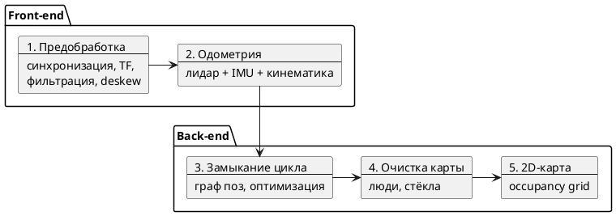

Контекст: [[2026-11-13 17-00 Вебинар Код города — Сервисная робототехника (транскрипт)]]

Сценарий 1: по записи полного обхода офиса (одно замыкание цикла) офлайн восстановить траекторию робота и построить 2D-карту помещения (occupancy grid).

## Этапы алгоритма

**1. Предобработка и синхронизация.**
- Привести все данные к одной шкале времени (датчики пишут с разной частотой, аппаратной синхронизации нет).
- Перевести измерения в систему координат базы робота через калибровки (TF).
- Обработать дефекты: пропуски сканов, разрывы времени.
- Отфильтровать облако: прореживание, выбросы, обрезка по дальности и высоте, точки на корпусе робота.
- По неподвижному отрезку в начале записи оценить смещение нуля (bias) IMU и направление гравитации.
- Убрать искажение лидарного облака от движения (deskew) с помощью IMU.
- *Очистка — в каждом скане отдельно, положения не нужны:*
	- шум: одиночные точки и мелкие кластеры;
	- явные отражения от стёкол: точки «за стеной», аномальная интенсивность.

**2. Одометрия.** Пошаговая оценка движения; ошибка со временем накапливается.
- Поэтапно: лидар + IMU + кинематика (FAST-LIO2, Point-LIO; без IMU — KISS-ICP, ICP/NDT), потом камера. Визуальную одометрию по точкам (VINS-Fusion, ORB-SLAM3) добавить через EKF или как связи в графе поз. Проще отлаживать, меньше зависит от синхронизации.
- Сразу все датчики: камера + лидар + IMU в одном алгоритме (LVI-SAM). Только методы по признакам: прямым (FAST-LIVO2, R3LIVE) нужны пиксели, а дают лишь точки. Точнее, если синхронизация и калибровка хорошие.
	- Кинематику такие алгоритмы из коробки не принимают. Если дадут только одометрию корпуса — объединить с результатом алгоритма отдельно или встроить в сам алгоритм, доработав его код.
- Главная сложность: длинные коридоры без текстуры. В них лидарная одометрия «скользит» вдоль коридора — нужно распознавать такое вырождение и в этом направлении опираться на кинематику и IMU.
- *Очистка — опционально:* движущиеся точки можно отсекать прямо в потоке сканов (M-detector, Dynablox), чтобы люди не сбивали одометрию. Для простого датасета, скорее всего, не нужно.

**3. Замыкание цикла и оптимизация.**
- Граф поз: узлы — ключевые положения робота, рёбра — смещения из одометрии.
- Обнаружение замыкания: робот вернулся в пройденное место (близость положения, Scan Context, проверка через ICP).
- Оптимизация графа распределяет накопленную ошибку по всей траектории: GTSAM, g2o, slam_toolbox, Cartographer.
- План помещения можно использовать как дополнительное ограничение.
- По исправленным положениям сканы заново собираются в общую карту.

**4. Очистка карты.** Только то, что требует точно совмещённых сканов, поэтому после оптимизации: при ошибке в положениях метод сотрёт настоящие стены.
- Убрать людей: точки, сквозь которые в других сканах проходит луч, считаются динамическими (ray casting, ERASOR, Removert). Распознавать людей не требуется.
- Обработать стёкла: лучи, прошедшие сквозь стекло.

**5. Построение 2D occupancy grid.**
- Срез 3D-облака по диапазону высот и проекция на плоскость.
- Занятость клеток по лучам (log-odds): пройденные лучом клетки — свободные, конечная — занятая.
- Итог: занято / свободно / неизвестно.
- *Очистка — встроена:* log-odds сам гасит кратковременные объекты: клетку, где недолго стоял человек, другие лучи отмечают свободной. Если карта получается чистой, удаление людей в этапе 4 можно пропустить.
